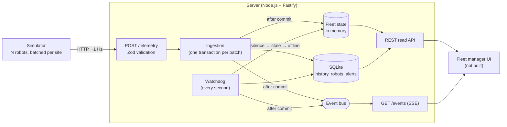

# Fleet Telemetry Service

A backend for robot fleet management. Robots across several sites report their state about once per second; the service ingests that telemetry, stores it, and tells a fleet manager **what the fleet is doing right now**: which robots are healthy, which have gone silent, and which need attention.

It includes a **robot simulator** that produces realistic telemetry, including the awkward cases: robots that go silent, data that arrives late or twice, batteries running low, faults and wrong clocks.

## Quick start

Requires [Docker](https://docs.docker.com/get-docker/).

```bash
docker compose up --build
```

This starts the server on port 3000 and a simulator with 20 robots on 3 sites. Then:

| What | Where |
|---|---|
| Fleet at a glance | http://localhost:3000/fleet/summary |
| Every robot, with its active alerts | http://localhost:3000/robots |
| Active alerts | http://localhost:3000/alerts?active=true |
| One robot's recent telemetry | http://localhost:3000/robots/robot-003/history?limit=20 |
| Live stream (open it in a browser) | http://localhost:3000/events |

Within about two minutes every scenario has played out: a low battery warning that escalates and recovers, a robot fault, a robot that goes offline and comes back, late and duplicate data, and a robot whose clock is wrong. `docker compose down -v` stops everything and deletes the data.

<details>
<summary>Running without Docker</summary>

Requires [Node.js 24](https://nodejs.org/) or later. There is no build step: Node.js runs the TypeScript sources directly.

```bash
npm ci
npm run dev        # server on http://localhost:3000, restarts on changes
npm run simulate   # in a second terminal
npm test
npm run typecheck
```

On Windows PowerShell, if `npm` fails with *"running scripts is disabled on this system"*, use `npm.cmd` instead (for example `npm.cmd run dev`). See [about_Execution_Policies](https://learn.microsoft.com/powershell/module/microsoft.powershell.core/about/about_execution_policies).

</details>

## What I built, and why

The challenge has three parts: a robot simulator, the server side and a user interface. **I focused on the server side**, because that is where I want to show depth: ingestion, storage, and the business logic that turns a stream of messages into an accurate picture of the fleet.

- **Server: built in depth.** Validation, idempotent ingestion, current state vs. history, connectivity tracking, stateful alerts, a read API and a live event stream, all covered by tests.
- **Simulator: built, kept simple.** The server needs data, and more importantly it needs *bad* data to prove its rules work. Each simulated scenario exists to exercise one server rule.
- **User interface: left out.** The API is shaped for one: a summary for the dashboard header, a robot list that already carries each robot's alerts, a detail and history view, and a stream that starts with a snapshot so a UI never has to poll.

## Architecture



The code is organised in layers; each one depends only on the ones below it:

| Layer | Responsibility |
|---|---|
| [`src/api/`](src/api) | HTTP: validate input with [Zod](https://zod.dev/), map responses (ISO 8601 timestamps), SSE |
| [`src/application/`](src/application) | Orchestration: transactions, in-memory fleet state, watchdog, alert engine, queries, event bus |
| [`src/domain/`](src/domain) | Business rules as **pure functions**: no I/O, the current time is passed in |
| [`src/storage/`](src/storage) | SQL: repositories, migrations |

The detailed design, with sequence and state diagrams, is in [docs/PLAN.md](docs/PLAN.md).

## How the system thinks about the fleet

### Current state vs. history

The two questions a fleet manager asks have different access patterns, so they are served differently:

- **"What is the fleet doing right now?"** is answered from an **in-memory map** with one entry per robot. Reading it never touches the database, and its size depends on the number of robots, not the number of messages.
- **"What happened to this robot?"** is answered from **SQLite**: an append-only history keyed by `(robot_id, timestamp)`.

A small `robots` table points at each robot's latest telemetry, so after a restart the in-memory state is rebuilt by reading one row per robot instead of scanning the history.

### When a robot goes silent

Silence produces no message, so a **watchdog** checks the clock every second, using the **server's** receive time, never the robot's clock:

| State | Time since the last message | Meaning |
|---|---|---|
| `online` | < 5 s | Reporting normally |
| `stale` | 5 – 30 s | Something may be wrong. A grey zone so a network hiccup does not raise an alert |
| `offline` | ≥ 30 s | Raises an `OFFLINE` alert, resolved when the robot reports again |

**After a restart**, every robot looks silent: the server cannot tell a robot's silence from its own downtime. To avoid a storm of false alerts, no new `OFFLINE` alerts are opened during the first 30 s after startup; robots that are still silent after that get their alert.

### When data arrives late, twice, or from the future

| Case | Behaviour |
|---|---|
| **Out of order / late** (older than the robot's latest) | Stored in history, but **never rolls the current state back**. Still counts as "seen". |
| **Duplicate** (a producer retry) | Ignored. The primary key makes ingestion idempotent, so producers can retry safely. |
| **Timestamp in the future** (> 30 s ahead) | Rejected. Otherwise one robot with a wrong clock would freeze its own state. |
| **Invalid payload** | The whole request is rejected with `400` and the exact invalid fields: a producer bug should be loud. |

### What deserves an alert

| Alert | Opens | Resolves |
|---|---|---|
| `LOW_BATTERY` | warning < 20 %, escalates to critical < 10 % | battery > 25 % |
| `OFFLINE` (critical) | robot offline | robot reports again |
| `ROBOT_ERROR` (critical) | robot reports `status: "error"` | status leaves `error` |

- **Alerts have state, not one per message**: at most one open alert per robot and type, enforced both in code and by a unique index. Evaluating the same state twice changes nothing.
- **Hysteresis**: the battery alert opens below 20 % but only resolves above 25 %, so a battery hovering around the threshold does not flap.
- **Severity only escalates** while an alert is open: it records the worst state reached. The robot's current battery is always visible on the robot itself.
- **A healthy robot raises no alerts**: simulated robots go to charge at 25 %, before the warning threshold.

## API

| Method | Path | Description |
|---|---|---|
| `POST` | `/telemetry` | Ingest one message or a batch (max 500). Returns `{ accepted, late, duplicates, rejected[] }`. |
| `GET` | `/fleet/summary` | Robots by connectivity, overall and per site; active alerts by severity. |
| `GET` | `/robots?siteId=&connectivity=` | Current state of every robot, with its active alerts. |
| `GET` | `/robots/:robotId` | One robot with its active alerts; `404` if it never reported. |
| `GET` | `/robots/:robotId/history?from=&to=&limit=` | Telemetry, newest first (`limit` 100 by default, max 1000). |
| `GET` | `/alerts?active=&robotId=&limit=` | Alerts, most recently opened first. |
| `GET` | `/events?robotId=` | Live [Server-Sent Events](https://developer.mozilla.org/en-US/docs/Web/API/Server-sent_events) stream: a `snapshot`, then `robot.updated` and `alert.opened` / `alert.escalated` / `alert.resolved`. |
| `GET` | `/health` | `200` when the service and its database are up, `503` otherwise. |

A telemetry message:

```json
{
  "robotId": "robot-001",
  "siteId": "warehouse-a",
  "timestamp": "2026-10-15T17:55:36.373Z",
  "battery": 72.5,
  "position": { "x": 3.5, "y": 7 },
  "status": "moving"
}
```

`status` is one of `idle`, `moving`, `charging`, `error`. Timestamps must include a UTC offset. Unknown fields are ignored, so robots with newer firmware keep working.

```bash
curl -X POST localhost:3000/telemetry -H "content-type: application/json" \
  -d '{"robotId":"r1","siteId":"s1","timestamp":"2026-10-15T17:55:36Z","battery":15,"position":{"x":0,"y":0},"status":"idle"}'
curl -N localhost:3000/events     # use curl.exe in Windows PowerShell
```

## Configuration

Everything is configured with environment variables. Invalid values, or thresholds that contradict each other, stop the server at startup with a clear error.

| Server | Default |
|---|---|
| `PORT` / `HOST` | `3000` / `0.0.0.0` |
| `LOG_LEVEL` | `info` |
| `DATABASE_PATH` | `data/fleet.db` |
| `STALE_AFTER_MS` / `OFFLINE_AFTER_MS` | `5000` / `30000` |
| `MAX_CLOCK_SKEW_MS` | `30000` |
| `BATTERY_WARNING_PCT` / `BATTERY_CRITICAL_PCT` / `BATTERY_RECOVERY_PCT` | `20` / `10` / `25` |
| `WATCHDOG_INTERVAL_MS` | `1000` |

| Simulator | Default |
|---|---|
| `SERVER_URL` | `http://localhost:3000` |
| `ROBOT_COUNT` | `20` |
| `SITES` | `warehouse-a,warehouse-b,warehouse-c` |
| `TICK_MS` | `1000` |
| `SEED` | random, printed at startup; set it to replay a run exactly |

## The simulator

Each simulated robot has two independent layers: **physics** (battery, position, status), which always advances, and **delivery**, which decides what reaches the server. Robots send through a per-site batch, like a site gateway, with **at-least-once delivery**: if the server is down, batches are queued and retried in order, so an outage loses no data.

The first robots each get one scenario; the rest behave normally:

| Robot | Scenario | Exercises |
|---|---|---|
| `robot-001` | `silent`: 60 s online, 45 s silent | stale → offline → `OFFLINE` alert → recovery |
| `robot-002` | `laggy`: buffers 10 s, sends shuffled, repeats a message | late, out-of-order and duplicate data |
| `robot-003` | `low-battery`: drains in about a minute | warning → critical → hysteresis recovery |
| `robot-004` | `faulty`: a fault about every 30 s | `ROBOT_ERROR` alert |
| `robot-005` | `skewed-clock`: clock two minutes ahead | rejected timestamps: this robot never appears |

Every 10 s the simulator logs what the server answered: accepted, late, duplicate and rejected messages, and any failed requests.

## Testing

```bash
npm test
```

- **Domain rules** are pure functions, tested with a fixed clock: late and duplicate data, clock skew, connectivity boundaries, alert lifecycle and hysteresis.
- **Storage** runs against an in-memory SQLite database: idempotent inserts, constraints, migrations, persistence across restarts and transaction rollback.
- **Services and API** are tested through Fastify's [`inject`](https://fastify.dev/docs/latest/Guides/Testing/), without opening a port. The SSE stream is tested over a real connection.
- **End to end:** a simulated fleet runs for three simulated minutes against the real app and must produce the expected alerts, late data, duplicates and rejections.

For the rules that matter most (hysteresis, the restart grace period, transactional writes, SSE cleanup) I deliberately broke the code to confirm the tests fail.

## Trade-offs: what I faked or left out

| Left out | Why it was the right trade here |
|---|---|
| **User interface** | The role is backend-focused; a polished server beats three half-built parts. The API is shaped for a UI. |
| **A message broker** (MQTT, Kafka) | HTTP is enough to show the ingestion logic and keeps the project to a single command. |
| **A real database server** | SQLite (Node's built-in [`node:sqlite`](https://nodejs.org/api/sqlite.html)) needs no extra container and no native dependency. Its API is still marked *release candidate* in Node 24. |
| **Authentication** | It does not change the core problem and would add setup for whoever runs this. |
| **Horizontal scaling** | Current state and the event bus live in memory, so this runs as a single instance. |
| **Retention and downsampling** | History grows without bound; at this scale and duration it does not matter. |
| **Metrics and dashboards** | Structured JSON logs ([Pino](https://getpino.io/), via Fastify) only. |

## What production would need

**Scale.** 100 robots at 1 Hz is about 8.6 million rows a day.
- Move history to a time-series database such as [TimescaleDB](https://docs.timescale.com/), with retention policies and downsampled aggregates for long time ranges.
- Run several instances: keep current state in a shared store (e.g. Redis) or partition robots across instances, and replace the in-process event bus with Redis Pub/Sub, NATS or Kafka.

**Ingestion and failure handling.**
- Use [MQTT](https://mqtt.org/mqtt-specification/), the IoT standard: persistent connections, delivery guarantees (QoS), and *Last Will* messages so the broker itself reports a disconnected robot.
- Put a durable log (Kafka) between ingestion and processing, so a slow database never pushes back on robots and events can be replayed.
- Send alert notifications (pager, Slack, email) through an **outbox** table, written in the same transaction as the alert, so no notification is lost if the process dies.

**Monitoring.**
- Metrics on the service itself: ingestion rate and latency, rejected and late messages per robot, watchdog tick duration, open SSE connections, and database size.
- Alerts on the service itself, not only on robots: ingestion stopped, error rate up, a whole site silent at once (alerting per site instead of one alert per robot).

**Security.** Per-robot credentials for ingestion (mTLS or tokens) so a compromised robot can be revoked alone; user authentication and roles for the read API; rate limiting.

## With more time

- A small dashboard on top of `/events`, to close the loop for the fleet manager.
- Correlate alerts: one "site unreachable" alert instead of twenty `OFFLINE` alerts when a whole site loses its network.
- Let operators acknowledge alerts, separately from resolving them.
- More alert types, such as a robot stuck (moving but not changing position).
- Cursor-based pagination for alerts, and downsampled history for long time ranges.

## Project structure

```
src/
  domain/        business rules: telemetry schema, fleet state, connectivity, alerts
  application/   fleet store, ingestion, watchdog, alert engine, queries, event bus
  storage/       SQLite: migrations, repositories, transactions
  api/           Fastify routes, response mapping, validation, SSE
  config.ts      environment variables
  app.ts         wiring (composition root)
  server.ts      entry point, graceful shutdown
simulator/       robot physics, delivery scenarios, sender
test/            mirrors src/ and simulator/
docs/PLAN.md     detailed design
```
