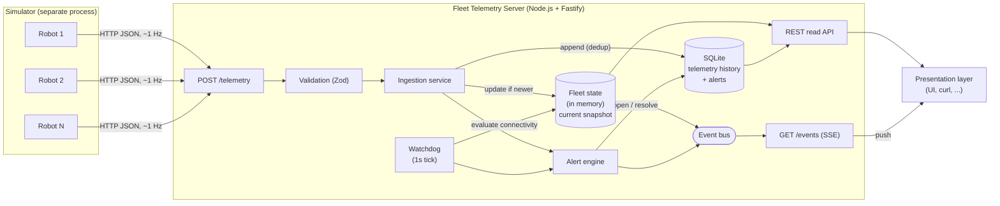
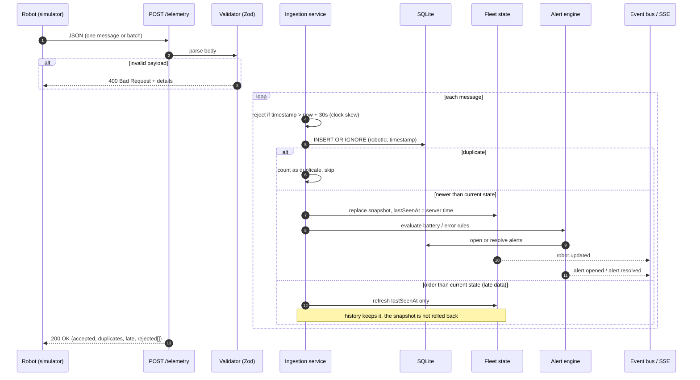
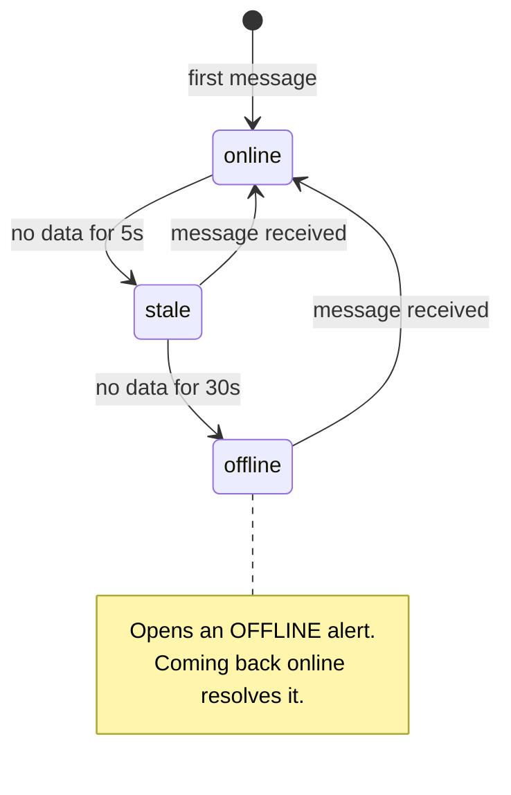
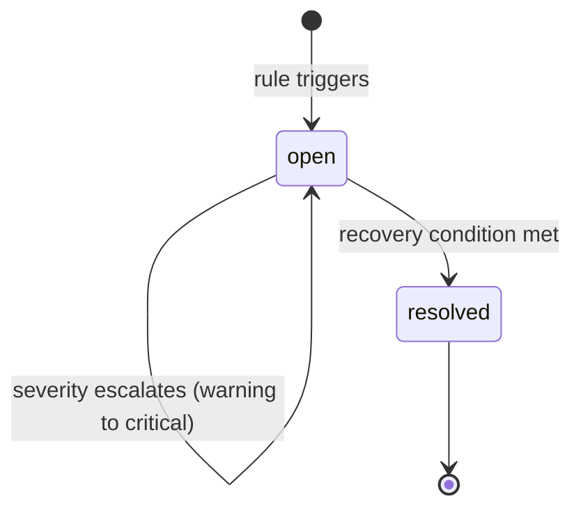

# Fleet Telemetry Service: Implementation Plan

This document describes what will be built, how it is structured, and which trade-offs were made up front. The README will summarise the final state; this plan records the reasoning behind it.

## 1. Goal

Robots deployed across several sites report their state (battery, position, status) about once per second. A fleet manager needs to know **what the fleet is doing right now**: which robots are healthy, which have gone silent, and which need attention.

This project focuses on the **server side**: ingestion, storage, the business logic in between, and an API for a presentation layer.

## 2. Scope

| Part | Decision | Rationale |
|---|---|---|
| Server side | **Built in depth** | Core of the challenge and the focus of the role. |
| Robot simulator | **Built, kept simple** | Needed to run the system end to end and to reproduce the hard cases on demand: silent robots, late data, low battery and faults. |
| User interface | **Left out** | The brief allows it. The API (REST + Server-Sent Events) is designed so a UI could consume it directly. |

## 3. Architecture



### Key design decision: current state vs. history

The two questions a fleet manager asks have very different access patterns, so they are served by different stores:

| Question | Store | Why |
|---|---|---|
| "What is the fleet doing right now?" | **In-memory fleet state** (one entry per robot) | Read on every dashboard refresh. It must be O(robots), not O(messages), and must not hit the database. |
| "What happened to this robot?" | **SQLite telemetry history** | Append-only and queried by robot and time range. |

On startup, the in-memory state is **rebuilt from the database** (latest record per robot and open alerts), so a restart does not lose the fleet picture.

### Transport

Robots send telemetry over **plain HTTP POST** (single message or batch). It is easy to run, inspect and test with `curl`.

In production, [MQTT](https://mqtt.org/mqtt-specification/) would be the natural choice: it is the de facto IoT standard, keeps a persistent connection, offers QoS levels, and its *Last Will and Testament* feature gives broker-level disconnect detection. This is documented as a production change, not implemented.

## 4. Data flow

### 4.1 Ingestion



### 4.2 Connectivity watchdog

A timer runs every second and re-evaluates every robot's connectivity using the **server's receive time**, never the robot's clock.



`stale` is a deliberate grey zone so a single network hiccup does not raise an alert.

### 4.3 Alert lifecycle

Alerts are **stateful**: at most one open alert per `(robotId, type)`. They are opened and resolved by rules; they are not emitted once per message.



## 5. Domain model

```typescript
// Sent by a robot
type Telemetry = {
  robotId: string;
  siteId: string;
  timestamp: string;              // robot clock, ISO 8601 / RFC 3339
  battery: number;                // 0-100 (%)
  position: { x: number; y: number };
  status: "idle" | "moving" | "charging" | "error";
};

// What the server knows about each robot (in memory)
type RobotState = {
  robotId: string;
  siteId: string;
  lastTelemetry: Telemetry;       // most recent by robot timestamp
  lastSeenAt: Date;               // server clock at last receipt
  connectivity: "online" | "stale" | "offline";
};

type Alert = {
  id: string;
  robotId: string;
  type: "LOW_BATTERY" | "OFFLINE" | "ROBOT_ERROR";
  severity: "warning" | "critical";
  message: string;
  openedAt: Date;
  resolvedAt: Date | null;
};
```

Zod schemas are the single source of truth: TypeScript types are inferred from them with `z.infer`, because TypeScript types do not exist at runtime and incoming data must be validated.

### Storage schema (SQLite)

```sql
CREATE TABLE telemetry (
  robot_id     TEXT    NOT NULL,
  site_id      TEXT    NOT NULL,
  ts           INTEGER NOT NULL,  -- robot timestamp, epoch ms
  received_at  INTEGER NOT NULL,  -- server timestamp, epoch ms
  battery      REAL    NOT NULL,
  pos_x        REAL    NOT NULL,
  pos_y        REAL    NOT NULL,
  status       TEXT    NOT NULL,
  PRIMARY KEY (robot_id, ts)      -- natural key: deduplicates retries
);

CREATE TABLE alerts (
  id           TEXT PRIMARY KEY,
  robot_id     TEXT    NOT NULL,
  type         TEXT    NOT NULL,
  severity     TEXT    NOT NULL,
  message      TEXT    NOT NULL,
  opened_at    INTEGER NOT NULL,
  resolved_at  INTEGER
);
CREATE INDEX idx_alerts_open ON alerts (robot_id, type) WHERE resolved_at IS NULL;
```

SQLite runs in [WAL mode](https://www.sqlite.org/wal.html) so reads do not block the writer.

## 6. Business rules

All rules live in `src/domain/` as **pure functions with an injected clock**, so they can be unit tested without timers or a database.

### 6.1 Late, duplicate and out-of-order data

| Case | Behaviour |
|---|---|
| Duplicate (`robotId` + `timestamp` already stored) | Ignored and counted as a duplicate. This makes producer retries safe (idempotent ingestion). |
| Older than the current snapshot | Stored in history; the snapshot is **not** rolled back; `lastSeenAt` is refreshed because the robot is evidently alive. |
| Timestamp more than 30 s in the future | Rejected (clock skew protection). Otherwise one bad clock would freeze the snapshot. |
| Invalid payload | `400` with validation details. |

### 6.2 Connectivity

| State | Condition (server time since last message) |
|---|---|
| `online` | < 5 s |
| `stale` | 5 s to 30 s |
| `offline` | > 30 s, opens an `OFFLINE` alert |

### 6.3 Alerts

| Type | Opens | Escalates | Resolves |
|---|---|---|---|
| `LOW_BATTERY` | battery < 20 % (warning) | battery < 10 % (critical) | battery > 25 % (**hysteresis**) |
| `OFFLINE` | watchdog marks robot offline | n/a | robot reports again |
| `ROBOT_ERROR` | `status = "error"` | n/a | status is no longer `error` |

Hysteresis prevents an alert from flapping when the battery hovers around the threshold (19.9 % → 20.1 % → 19.8 %…).

### 6.4 Configuration

All thresholds live in one config module and can be overridden with environment variables:

| Variable | Default |
|---|---|
| `STALE_AFTER_MS` | `5000` |
| `OFFLINE_AFTER_MS` | `30000` |
| `MAX_CLOCK_SKEW_MS` | `30000` |
| `BATTERY_WARNING_PCT` | `20` |
| `BATTERY_CRITICAL_PCT` | `10` |
| `BATTERY_RECOVERY_PCT` | `25` |
| `WATCHDOG_INTERVAL_MS` | `1000` |

## 7. API

| Method | Path | Purpose |
|---|---|---|
| `POST` | `/telemetry` | Ingest one message or a batch (max 500). Returns `{ accepted, duplicates, late, rejected[] }`. |
| `GET` | `/fleet/summary` | Counts by connectivity, by site, and active alerts by severity. |
| `GET` | `/robots?siteId=&connectivity=` | Current state of the fleet, filterable. |
| `GET` | `/robots/:id` | Current state of one robot plus its open alerts. |
| `GET` | `/robots/:id/history?from=&to=&limit=` | Telemetry history for a time range. |
| `GET` | `/alerts?active=true&robotId=` | Alerts, open or all. |
| `GET` | `/events` | Live stream ([Server-Sent Events](https://developer.mozilla.org/en-US/docs/Web/API/Server-sent_events)): `robot.updated`, `robot.connectivity`, `alert.opened`, `alert.resolved`. |
| `GET` | `/health` | Liveness and readiness (database reachable). |

SSE was chosen over WebSockets because the stream is one-directional (server to client), runs over plain HTTP, and browsers reconnect automatically via [`EventSource`](https://developer.mozilla.org/en-US/docs/Web/API/EventSource).

## 8. Simulator

A separate Node.js process that spawns N virtual robots spread across sites. Each one sends telemetry about once per second with a random walk for position and realistic battery drain and charge cycles.

Some robots are assigned **scenarios** to exercise the server's rules:

| Scenario | Behaviour | Exercises |
|---|---|---|
| `normal` | Steady 1 Hz telemetry | Happy path |
| `silent` | Stops sending for ~45 s, then resumes | `stale`, then `offline`, then the OFFLINE alert opens and resolves |
| `laggy` | Buffers messages and sends them late and shuffled | Out-of-order and late-data handling |
| `low-battery` | Drains fast, then charges | LOW_BATTERY warning, critical, and hysteresis recovery |
| `faulty` | Occasionally reports `status: "error"` | ROBOT_ERROR alert |

Configured with environment variables: `SERVER_URL`, `ROBOT_COUNT`, `SITES`.

## 9. Tech stack

| Concern | Choice | Docs |
|---|---|---|
| Runtime | Node.js 24 LTS | [nodejs.org](https://nodejs.org/en/about/previous-releases) |
| Language | TypeScript (strict mode) | [typescriptlang.org](https://www.typescriptlang.org/tsconfig/#strict) |
| HTTP server | Fastify | [fastify.dev](https://fastify.dev/docs/latest/) |
| Validation | Zod | [zod.dev](https://zod.dev/) |
| Storage | SQLite via better-sqlite3 | [better-sqlite3](https://github.com/WiseLibs/better-sqlite3/blob/master/docs/api.md), [sqlite.org](https://www.sqlite.org/docs.html) |
| Tests | Vitest | [vitest.dev](https://vitest.dev/guide/) |
| Packaging | Docker Compose | [docs.docker.com](https://docs.docker.com/compose/) |

Why SQLite: it needs no separate server, so the project runs with one command, and it is more than enough for a single-node service at this scale. See section 11 for the production alternative.

## 10. Project structure

```
.
├── docs/
│   └── PLAN.md
├── src/
│   ├── domain/            # pure business rules (unit tested)
│   │   ├── telemetry.ts   # Zod schemas + inferred types
│   │   ├── fleet-state.ts # snapshot updates, late-data handling
│   │   ├── connectivity.ts
│   │   └── alerts.ts
│   ├── ingestion/         # orchestrates domain + storage + events
│   ├── storage/           # SQLite repositories and migrations
│   ├── api/               # Fastify routes (REST + SSE)
│   ├── config.ts
│   └── server.ts          # composition root
├── simulator/
│   └── index.ts
├── test/                  # unit + API integration tests
├── docker-compose.yml
├── Dockerfile
└── README.md
```

## 11. Testing strategy

- **Unit tests** on `src/domain/`: late and duplicate data, clock skew, connectivity transitions, alert open, escalate and resolve, and battery hysteresis. A fake clock makes time-based rules deterministic.
- **API integration tests** with Fastify's [`inject`](https://fastify.dev/docs/latest/Guides/Testing/) against an in-memory SQLite database (`:memory:`). These exercise the real HTTP layer without opening a port.

## 12. Out of scope, and what production would need

| Area | This project | Production |
|---|---|---|
| Transport | HTTP POST | MQTT broker (QoS, Last Will for disconnect detection) or a log such as Kafka for replay |
| History storage | SQLite, single file | Time-series database such as [TimescaleDB](https://docs.timescale.com/) with retention policies and downsampling (continuous aggregates) |
| Scale | Single instance; state in memory | Shared state (e.g. Redis) or partitioning robots by ID across instances |
| Data volume | Unbounded | 100 robots × 1 Hz ≈ 8.6 M rows/day, so retention and downsampling are mandatory |
| Auth | None | Per-robot credentials (mTLS or tokens) for ingestion; user auth and RBAC for the read API |
| Observability | Structured logs (Fastify's built-in [Pino](https://getpino.io/)) | Metrics (ingest rate, lag, rejected messages), tracing, dashboards, and alerting on the service itself |
| Alert delivery | Exposed via API and SSE | Notification channels (email, pager, Slack), acknowledgement and silencing |
| UI | Not built | Fleet dashboard consuming `/fleet/summary`, `/robots` and `/events` |

## 13. Milestones

Each milestone is one or more small, focused commits.

1. Project skeleton: TypeScript config, Fastify, `/health`, Vitest set up.
2. Domain: Zod schemas, fleet-state rules, connectivity, alerts, plus unit tests.
3. Storage: SQLite schema, repositories, and state rehydration on startup.
4. Ingestion endpoint wired to domain and storage, plus API tests.
5. Watchdog and alert engine running on a timer.
6. Read endpoints: summary, robots, history, alerts.
7. Simulator with scenarios.
8. SSE `/events` stream.
9. Docker Compose (one-command run) and the final README.
