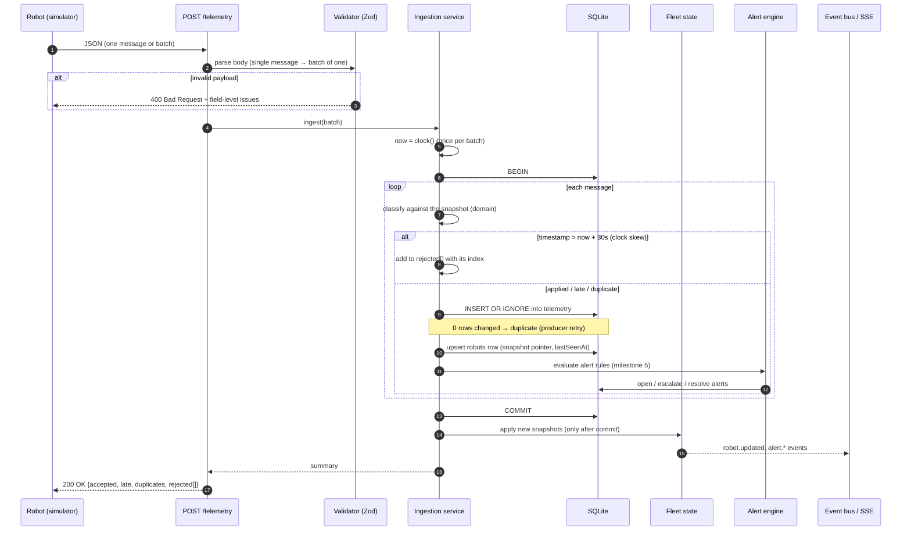
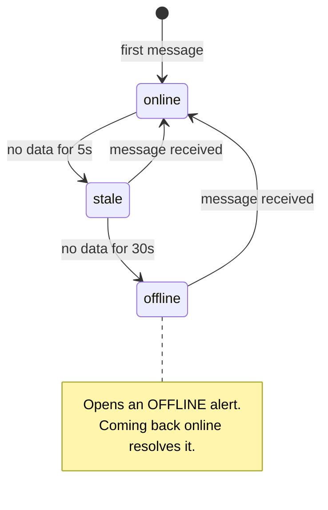
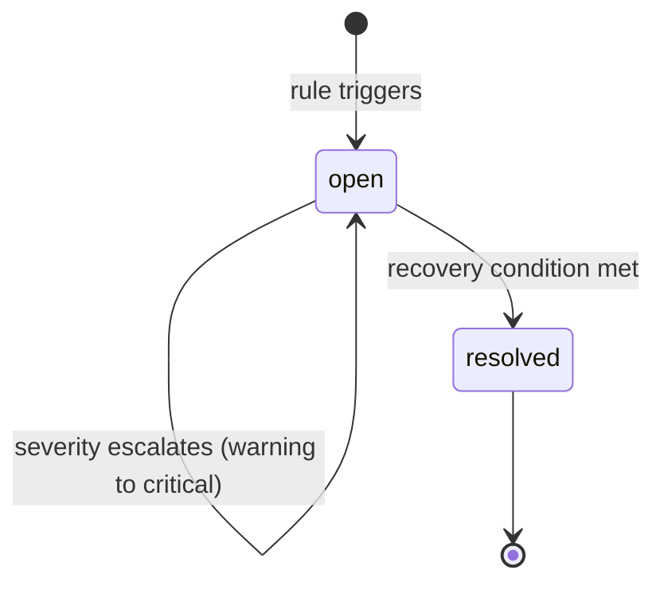
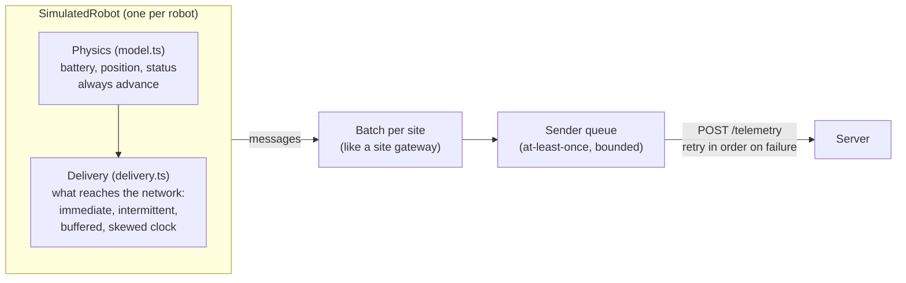

# Fleet Telemetry Service: Implementation Plan

This document describes what will be built, how it is structured, and which trade-offs were made up front. The README will summarise the final state; this plan records the reasoning behind it.

## 1. Goal

Robots deployed across several sites report their state (battery, position, status) about once per second. A fleet manager needs to know **what the fleet is doing right now**: which robots are healthy, which have gone silent, and which need attention.

This project focuses on the **server side**: ingestion, storage, the business logic in between, and an API for a presentation layer.

## 2. Scope

| Part | Decision | Rationale |
|---|---|---|
| Server side | **Built in depth** | Core of the challenge and the focus of the role. |
| Robot simulator | **Built, kept simple** | Needed to run the system end to end and to reproduce the hard cases on demand: silent robots, late data, low battery and faults. |
| User interface | **Left out** | The brief allows it. The API (REST + Server-Sent Events) is designed so a UI could consume it directly. |

## 3. Architecture


### Key design decision: current state vs. history

The two questions a fleet manager asks have very different access patterns, so they are served by different stores:

| Question | Store | Why |
|---|---|---|
| "What is the fleet doing right now?" | **In-memory fleet state** (one entry per robot) | Read on every dashboard refresh. It must be O(robots), not O(messages), and must not hit the database. |
| "What happened to this robot?" | **SQLite telemetry history** | Append-only and queried by robot and time range. |

On startup, the in-memory state is **rebuilt from the database** (latest record per robot and open alerts), so a restart does not lose the fleet picture.

### Transport

Robots send telemetry over **plain HTTP POST** (single message or batch). It is easy to run, inspect and test with `curl`.

In production, [MQTT](https://mqtt.org/mqtt-specification/) would be the natural choice: it is the de facto IoT standard, keeps a persistent connection, offers QoS levels, and its *Last Will and Testament* feature gives broker-level disconnect detection. This is documented as a production change, not implemented.

## 4. Data flow

### 4.1 Ingestion



- **Late data** (older than the snapshot) is stored in history but never rolls the snapshot back; it still refreshes `lastSeenAt`.
- **Memory is updated after the commit**, so the in-memory state never shows data the database does not have. If the database fails, the whole batch rolls back and the producer retries; ingestion is idempotent, so retries are safe.
- An **invalid payload rejects the whole request** (a producer bug should be loud), while a future timestamp rejects only that message (an operational problem with one robot's clock).

### 4.2 Connectivity watchdog

A silent robot produces no message, so something has to look at the clock: a timer runs every second and re-evaluates every robot's connectivity using the **server's receive time**, never the robot's clock.

- Only robots whose connectivity **changed** on this tick have their alerts evaluated, so a quiet fleet costs no database work.
- Alert changes are written in one transaction per tick; the in-memory state is updated after the commit.
- A failing tick is logged and retried on the next one; it never crashes the process.
- **Startup grace period:** for `offlineAfterMs` after startup, the watchdog does not open new `OFFLINE` alerts (see *Restart behaviour*). When the period ends, every robot is evaluated once, so robots that are still silent get their alert.



`stale` is a deliberate grey zone so a single network hiccup does not raise an alert.

### 4.3 Alert lifecycle

Alerts are **stateful**: at most one open alert per `(robotId, type)`. They are opened and resolved by rules; they are not emitted once per message.



## 5. Domain model

```typescript
// Sent by a robot
type Telemetry = {
  robotId: string;
  siteId: string;
  timestamp: string;              // robot clock, ISO 8601 / RFC 3339
  battery: number;                // 0-100 (%)
  position: { x: number; y: number };
  status: "idle" | "moving" | "charging" | "error";
};

// What the server knows about each robot (in memory)
type RobotState = {
  robotId: string;
  siteId: string;
  lastTelemetry: Telemetry;       // most recent by robot timestamp
  lastSeenAt: number;             // server clock at last receipt, epoch ms
  connectivity: "online" | "stale" | "offline";
};

type Alert = {
  id: string;
  robotId: string;
  type: "LOW_BATTERY" | "OFFLINE" | "ROBOT_ERROR";
  severity: "warning" | "critical";
  message: string;
  openedAt: number;               // epoch ms
  resolvedAt: number | null;
};
```

Inside the server, all times are **epoch milliseconds** (`number`): they compare with `<`, store as SQLite integers and carry no time zone ambiguity. ISO 8601 strings are used only at the API boundary.

Zod schemas are the single source of truth: TypeScript types are inferred from them with `z.infer`, because TypeScript types do not exist at runtime and incoming data must be validated.

### Storage schema (SQLite)

```sql
-- Append-only history
CREATE TABLE telemetry (
  robot_id     TEXT    NOT NULL,
  site_id      TEXT    NOT NULL,
  ts           INTEGER NOT NULL,  -- robot timestamp, epoch ms
  received_at  INTEGER NOT NULL,  -- server timestamp, epoch ms
  battery      REAL    NOT NULL,
  pos_x        REAL    NOT NULL,
  pos_y        REAL    NOT NULL,
  status       TEXT    NOT NULL,
  PRIMARY KEY (robot_id, ts)      -- natural key: deduplicates retries
) WITHOUT ROWID;

-- Current snapshot pointer: one row per robot
CREATE TABLE robots (
  robot_id      TEXT    PRIMARY KEY,
  site_id       TEXT    NOT NULL,
  last_ts       INTEGER NOT NULL,
  last_seen_at  INTEGER NOT NULL,
  FOREIGN KEY (robot_id, last_ts) REFERENCES telemetry (robot_id, ts)
);

CREATE TABLE alerts (
  id           TEXT PRIMARY KEY,
  robot_id     TEXT    NOT NULL,
  type         TEXT    NOT NULL,
  severity     TEXT    NOT NULL,
  message      TEXT    NOT NULL,
  opened_at    INTEGER NOT NULL,
  resolved_at  INTEGER
);
-- The database enforces the domain invariant too: one open alert per robot and type
CREATE UNIQUE INDEX alerts_one_open_per_type ON alerts (robot_id, type) WHERE resolved_at IS NULL;
```

- **`robots` table:** rebuilding the in-memory state on startup reads one row per robot (O(robots)) instead of deriving the latest record from the whole history (O(messages)). The foreign key guarantees the pointer always references stored telemetry.
- **Migrations:** an ordered list of SQL scripts; [`PRAGMA user_version`](https://www.sqlite.org/pragma.html#pragma_user_version) records how many have been applied. Each runs in a transaction.
- **[WAL mode](https://www.sqlite.org/wal.html)** with `synchronous = NORMAL`: cheaper frequent small writes, and other processes (e.g. the `sqlite3` CLI) can read while the server writes. A power loss may drop the last commits but cannot corrupt the file.
- **Driver:** Node's built-in [`node:sqlite`](https://nodejs.org/api/sqlite.html) module. It removes a native dependency (`better-sqlite3` compiles C++ on install), which keeps the Docker image simple. Trade-off: its stability index is *1.2 Release candidate* in Node 24. Its API is synchronous like `better-sqlite3`; queries take microseconds on a local file, so blocking the event loop briefly is cheaper than the overhead of async I/O.

### Restart behaviour

On startup the server loads every robot from the `robots` table and derives its connectivity from `last_seen_at`. After downtime, every robot will look `offline`: the server cannot tell a silent robot apart from its own outage. To avoid an alert storm on restart, the watchdog applies a **startup grace period** (`offlineAfterMs`) before opening new `OFFLINE` alerts; robots that report during that window simply come back online. Alerts that were already open before the restart are loaded from the database and stay open.

## 6. Business rules

All rules live in `src/domain/` as **pure functions with an injected clock**, so they can be unit tested without timers or a database.

### 6.1 Late, duplicate and out-of-order data

| Case | Behaviour |
|---|---|
| Duplicate (`robotId` + `timestamp` already stored) | Ignored and counted as a duplicate. This makes producer retries safe (idempotent ingestion). |
| Older than the current snapshot | Stored in history; the snapshot is **not** rolled back; `lastSeenAt` is refreshed because the robot is evidently alive. |
| Timestamp more than 30 s in the future | Rejected (clock skew protection). Otherwise one bad clock would freeze the snapshot. |
| Invalid payload | `400` with validation details. |

### 6.2 Connectivity

| State | Condition (server time since last message) |
|---|---|
| `online` | < 5 s |
| `stale` | ≥ 5 s and < 30 s |
| `offline` | ≥ 30 s, opens an `OFFLINE` alert |

### 6.3 Alerts

| Type | Severity | Opens | Escalates | Resolves |
|---|---|---|---|---|
| `LOW_BATTERY` | warning / critical | battery < 20 % (warning), < 10 % (critical) | warning → critical when battery < 10 % | battery > 25 % (**hysteresis**) |
| `OFFLINE` | critical | watchdog marks robot `offline` | n/a | robot is `online` again (`stale` does not resolve it) |
| `ROBOT_ERROR` | critical | `status = "error"` | n/a | status is no longer `error` |

- **Hysteresis** prevents an alert from flapping when the battery hovers around the threshold (19.9 % → 20.1 % → 19.8 %…).
- **Severity only escalates** while an alert is open: it records the worst state reached. The robot's current battery is always available on the robot itself.
- Rules are **idempotent**: evaluating the same state twice yields no changes, so they run on every message and on every watchdog tick.
- **Open alerts live only in the database.** Each evaluation reads a robot's open alerts with an indexed lookup, so there is no in-memory copy that could disagree with it.
- During ingestion, alerts are evaluated **once per robot per batch**, on its final state: a batch where the battery dips and recovers does not open and immediately resolve an alert.

### 6.4 Configuration

Everything is configured with environment variables (`src/config.ts`):

| Variable | Default | Notes |
|---|---|---|
| `PORT` | `3000` | |
| `HOST` | `0.0.0.0` | Reachable from outside a container |
| `LOG_LEVEL` | `info` | |
| `DATABASE_PATH` | `data/fleet.db` | Directory is created if missing |
| `STALE_AFTER_MS` | `5000` | Must be lower than `OFFLINE_AFTER_MS` |
| `OFFLINE_AFTER_MS` | `30000` | Also the startup grace period |
| `MAX_CLOCK_SKEW_MS` | `30000` | |
| `BATTERY_WARNING_PCT` | `20` | |
| `BATTERY_CRITICAL_PCT` | `10` | Must be lower than the warning threshold |
| `BATTERY_RECOVERY_PCT` | `25` | Must not be lower than the warning threshold |
| `WATCHDOG_INTERVAL_MS` | `1000` | |

Invalid values, or thresholds that contradict each other, **stop the server at startup** with a clear error instead of misbehaving later.

## 7. API

| Method | Path | Purpose |
|---|---|---|
| `POST` | `/telemetry` | Ingest one message or a batch (max 500). Returns `{ accepted, late, duplicates, rejected[] }`. |
| `GET` | `/fleet/summary` | Counts by connectivity, by site, and active alerts by severity, with `generatedAt`. |
| `GET` | `/robots?siteId=&connectivity=` | Current state of every robot, with its active alerts, sorted by id. |
| `GET` | `/robots/:id` | Current state of one robot plus its active alerts. `404` if it never reported. |
| `GET` | `/robots/:id/history?from=&to=&limit=` | Telemetry history, newest first. `limit` defaults to 100 (max 1000). |
| `GET` | `/alerts?active=&robotId=&limit=` | Alerts, most recently opened first. `limit` defaults to 100 (max 1000). |
| `GET` | `/events` | Live stream ([Server-Sent Events](https://developer.mozilla.org/en-US/docs/Web/API/Server-sent_events)): `robot.updated`, `robot.connectivity`, `alert.opened`, `alert.resolved`. |
| `GET` | `/health` | Liveness and readiness (database reachable); `503` otherwise. |

- **Timestamps are ISO 8601 (UTC) in every response**; epoch milliseconds stay inside the server.
- **Current state is served from memory**; history and alerts from SQLite. Each robot in `/robots` carries its active alerts (read for the whole fleet in a single query), so a client can show at a glance which robots need attention.
- **Every list is bounded** by `limit`, so a single request cannot read a whole table.
- **Errors** share one shape: `{ error, issues?: [{ path, message }] }`, with `400` for invalid input and `404` for unknown robots.
- Connectivity in responses is the value maintained by the watchdog, so it is at most one watchdog interval (1 s) old, and always consistent with the alerts.

Example: `GET /robots/r1`

```json
{
  "robotId": "r1",
  "siteId": "warehouse-1",
  "connectivity": "online",
  "lastSeenAt": "2026-10-15T17:55:36.608Z",
  "telemetry": {
    "timestamp": "2026-10-15T17:55:36.373Z",
    "battery": 12,
    "position": { "x": 3.5, "y": 7 },
    "status": "moving"
  },
  "activeAlerts": [
    {
      "id": "42b4c729-622d-44ed-bea5-0dc5f68b2e1e",
      "robotId": "r1",
      "type": "LOW_BATTERY",
      "severity": "warning",
      "message": "Battery at 12%",
      "openedAt": "2026-10-15T17:55:36.608Z",
      "resolvedAt": null
    }
  ]
}
```

SSE was chosen over WebSockets because the stream is one-directional (server to client), runs over plain HTTP, and browsers reconnect automatically via [`EventSource`](https://developer.mozilla.org/en-US/docs/Web/API/EventSource).

## 8. Simulator

A separate Node.js process (`simulator/`) that plays N robots spread across sites. It shares only **types** with the server (erased at runtime), never server code: it stands in for a separate system.



- **Physics** (`simulator/model.ts`): a random walk inside a 100 m × 100 m site, battery drain while working (a third of it while idle), charge cycles, and faults. A robot keeps "living" while it is not transmitting.
- **Delivery** (`simulator/delivery.ts`): each scenario decides which messages leave the robot and when.
- **One batch per site per tick**, as a site gateway would: with 20 robots that is 3 requests per second instead of 20.
- **At-least-once delivery**: a batch stays queued until the server confirms it and is retried in order, so a server outage loses no data (safe because ingestion is idempotent). The queue is bounded (five minutes of batches) and drops the oldest beyond that. A `4xx` drops the batch, since retrying an invalid batch would fail forever.
- **Reproducible runs**: randomness comes from a seeded generator; `SEED` replays the exact same fleet.

The first robots get one **scenario** each; the rest are `normal`:

| Scenario | Behaviour | Exercises |
|---|---|---|
| `normal` | Steady 1 Hz telemetry; charges at 25 %, before the warning threshold | Happy path: no alerts |
| `silent` | 60 s online, then 45 s of silence, repeatedly | `stale`, then `offline` and the OFFLINE alert, then recovery |
| `laggy` | Buffers messages for 10 s and sends them shuffled, repeating one from the previous flush | Late, out-of-order and duplicate data; `stale` between flushes |
| `low-battery` | Drains in about a minute, charges only at 5 % | LOW_BATTERY warning, escalation to critical, hysteresis recovery |
| `faulty` | A fault roughly every 30 s, lasting about 10 s | ROBOT_ERROR open and resolve |
| `skewed-clock` | Clock two minutes ahead | Rejection of future timestamps (the robot never appears) |

| Variable | Default |
|---|---|
| `SERVER_URL` | `http://localhost:3000` |
| `ROBOT_COUNT` | `20` |
| `SITES` | `warehouse-a,warehouse-b,warehouse-c` |
| `TICK_MS` | `1000` |
| `SEED` | random (printed at startup) |

Every 10 seconds the simulator logs what the server answered: accepted, late, duplicate and rejected messages, failed requests, dropped and queued batches.

## 9. Tech stack

| Concern | Choice | Docs |
|---|---|---|
| Runtime | Node.js 24 LTS | [nodejs.org](https://nodejs.org/en/about/previous-releases) |
| Language | TypeScript (strict mode) | [typescriptlang.org](https://www.typescriptlang.org/tsconfig/#strict) |
| HTTP server | Fastify | [fastify.dev](https://fastify.dev/docs/latest/) |
| Validation | Zod | [zod.dev](https://zod.dev/) |
| Storage | SQLite via the built-in `node:sqlite` module | [nodejs.org](https://nodejs.org/api/sqlite.html), [sqlite.org](https://www.sqlite.org/docs.html) |
| Tests | Vitest | [vitest.dev](https://vitest.dev/guide/) |
| Packaging | Docker Compose | [docs.docker.com](https://docs.docker.com/compose/) |

Why SQLite: it needs no separate server, so the project runs with one command, and it is more than enough for a single-node service at this scale. See section 11 for the production alternative.

## 10. Project structure

```
.
├── docs/
│   └── PLAN.md
├── src/
│   ├── domain/            # pure business rules (unit tested)
│   │   ├── telemetry.ts   # Zod schemas + inferred types
│   │   ├── fleet-state.ts # snapshot updates, late-data handling
│   │   ├── connectivity.ts
│   │   └── alerts.ts
│   ├── application/       # orchestrates domain + storage: in-memory fleet store,
│   │                      # ingestion service, watchdog, alert engine
│   ├── storage/           # SQLite repositories and migrations
│   ├── api/               # Fastify routes (REST + SSE)
│   ├── config.ts
│   └── server.ts          # composition root
├── simulator/             # robot fleet: physics, delivery scenarios, sender
│   ├── model.ts
│   ├── delivery.ts
│   ├── robot.ts
│   ├── fleet.ts
│   ├── sender.ts
│   └── index.ts
├── test/                  # unit + API integration tests
├── docker-compose.yml
├── Dockerfile
└── README.md
```

## 11. Testing strategy

- **Unit tests** on `src/domain/`: late and duplicate data, clock skew, connectivity transitions, alert open, escalate and resolve, and battery hysteresis. A fake clock makes time-based rules deterministic.
- **API integration tests** with Fastify's [`inject`](https://fastify.dev/docs/latest/Guides/Testing/) against an in-memory SQLite database (`:memory:`). These exercise the real HTTP layer without opening a port.

## 12. Out of scope, and what production would need

| Area | This project | Production |
|---|---|---|
| Transport | HTTP POST | MQTT broker (QoS, Last Will for disconnect detection) or a log such as Kafka for replay |
| History storage | SQLite, single file | Time-series database such as [TimescaleDB](https://docs.timescale.com/) with retention policies and downsampling (continuous aggregates) |
| Scale | Single instance; state in memory | Shared state (e.g. Redis) or partitioning robots by ID across instances |
| Data volume | Unbounded | 100 robots × 1 Hz ≈ 8.6 M rows/day, so retention and downsampling are mandatory |
| Auth | None | Per-robot credentials (mTLS or tokens) for ingestion; user auth and RBAC for the read API |
| Observability | Structured logs (Fastify's built-in [Pino](https://getpino.io/)) | Metrics (ingest rate, lag, rejected messages), tracing, dashboards, and alerting on the service itself |
| Alert delivery | Exposed via API and SSE | Notification channels (email, pager, Slack), acknowledgement and silencing |
| UI | Not built | Fleet dashboard consuming `/fleet/summary`, `/robots` and `/events` |

## 13. Milestones

Each milestone is one or more small, focused commits.

1. Project skeleton: TypeScript config, Fastify, `/health`, Vitest set up.
2. Domain: Zod schemas, fleet-state rules, connectivity, alerts, plus unit tests.
3. Storage: SQLite schema, repositories, and state rehydration on startup.
4. Ingestion endpoint wired to domain and storage, plus API tests.
5. Watchdog and alert engine running on a timer.
6. Read endpoints: summary, robots, history, alerts.
7. Simulator with scenarios.
8. SSE `/events` stream.
9. Docker Compose (one-command run) and the final README.
